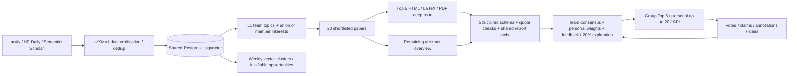

# Team AI Research Copilot · v0.1

## Product boundary

Cloud-first research backend; frontend is delegated to a separate UI agent by the user.
This release supplies API, data ingestion, shared evidence-checked analysis, routing,
collaboration, scheduled pipeline code and deployment configuration. Live deployment depends
on the owner's connected Supabase, GitHub, Render and model-provider credentials.

## Data flow

## Storage and sharing

- `papers`: global public metadata. arXiv IDs are versionless for dedup; the latest fetched
  version is separate. `first_submitted_at` comes from arXiv `published`, never `updated`.
- `fetch_cache`, `documents`: public responses and extracted text in PostgreSQL; ephemeral
  Actions/Render disks are not used as persistent storage. HTML anchors, LaTeX file anchors,
  PDF page anchors and truncation status are retained.
- `paper_analyses`: neutral public reports and vector(1536), keyed by paper/version/source,
  model, report tier, content and prompt hash. Advisory lock + unique key prevent duplicate
  concurrent analysis. Sharing operates across members and teams in the same deployment;
  it does not mean one report forever across revised papers, prompt changes or tiers.
- `users`, `teams`, `memberships`, `team_topics`: verified auth subjects, team-scoped role
  and interests. Default topics are explicitly examples, not a confirmed user profile.
- `team_papers`: each team's library and relevance scores. Team relevance is scored once
  against the union of member interests, not once per member.
- `annotations`, `claims`, `votes`, `ideas`: team-private collaborative state. A team paper
  has at most one claimant per meeting date; votes upsert per user/paper/team.
- `invitations`: administrator-issued, email-bound, seven-day member access grants; revocable,
  accepted only using the canonical email of a validated Auth identity. No automatic email sending.
- `join_requests`: applicant-owned pending/approved/rejected/cancelled requests. Only teams that
  opt in expose their name and ID to authenticated applicants. Admin approval grants a normal
  membership atomically; rejected/withdrawn requests never grant access. Resubmissions use new
  IDs, and replaying an old approval cannot re-add a subsequently removed member.
- `paper_states`: each account's private bookmarks, read flags and notes, additionally team scoped.
- `digests`, `weekly_reports`, `deliveries`, `job_runs`: persisted outcomes and audit state.
- `daily_editions`: shared team/day candidate IDs and team selections, stored even without members.
  Late joiners route this pool using their own interests, without model calls or private feed copying.
- `budget_usage`, `llm_calls`: global and team daily token ledgers with row locks.

All business tables are in private schema `copilot`, outside default Supabase Data API exposure.
Frontend uses FastAPI only, never the service-role key or a direct database connection.
API validates issuer, audience, expiration and asymmetric JWT signature via Supabase JWKS.
SSO identity alone grants no team membership. Bootstrap is an operator CLI action.

## Ranking and costs

Default: <=200 verified candidates → 20 shortlist → 5 full-text deep reports + 15 abstract overviews.
For each member, rank = 0.50 team match + 0.30 personal match + 0.15 team feedback + 0.05 abstract
specificity. Weights normalize by their sum. New members fall back to team weights.
About 20% of the final list is reserved for high-quality adjacent candidates. When the source
pool lacks eligible adjacent work, report the actual quota; never relabel core work to fake 20%.
Votes and claims influence the next pipeline run; the saved daily digest is a dated snapshot.

Paid calls reserve a conservative UTF-8 byte input bound + maximum output tokens + framing
headroom atomically for global and paying team budgets, then settle actual usage. A deep
request that cannot fit falls back to a medium request; depleted budgets use metadata and
keyword routing. Ambiguous paid-call failures keep reservations to avoid hidden overspend.
In `BUDGET_MODE=tokens`, only the explicit global token cap and team quotas apply. Current owner
authorization is 20,000,000 input+output tokens/day shared by the team; currency limits are disabled.
In `BUDGET_MODE=currency`, DeepSeek Flash additionally clamps the global token limit using
the peak output rate for every token. Detailed input/output/cache usage provides a peak-price
cost upper estimate; this is not a provider invoice. Other models remain unpriced unless an
explicit rate is supplied. Price changes require rechecking this guard.

## Evidence quality

Schema separates `paper_facts`, `critical_gaps` (author-stated/inferred), and
`testable_hypotheses` (experiment/metric/falsification). Each has an anchor and source quote.
Quote checks prove text occurrence, not that the conclusion logically follows. Free-form
summaries and reviewer text still require human review. Reports state abstract vs full text
and truncation. Gold-set templates are empty until the team supplies expert judgements.

## Scheduling and delivery

GitHub Actions: daily 00:30 UTC / Beijing 08:30; Friday 08:00 UTC / Beijing 16:00
reading-list snapshot; Sunday 02:00 UTC weekly synthesis.
Actions scheduling is best effort and may be delayed. `PIPELINE_ENABLED` defaults off.
One global source fetch is shared by all teams. Pipeline and analysis locks require a direct
or session-pooler database connection; do not use transaction pooling for this deployment.
Group webhook is bound to an explicit `IM_TEAM_ID` to prevent cross-team sends.
Group buttons open the authenticated paper page; direct IM identity-to-user claim callbacks
are deferred. Personal digests persist in-app; email is separately configured and opt-in.
Personal email supports Resend or direct SMTP with TLS on 465/587, duplicate prevention and
uncertain delivery tracking. Supabase Auth SMTP credentials are separate and never extracted.

Weekly synthesis prefers vector clustering. With no embedding groups it uses explicit team-topic
scores and labels `grouping_method=team_topics`; this does not provide semantic search.

## Acceptance boundaries

Automated checks: date validation, dedup, exploration quota, evidence matching, source parsing,
unauthenticated rejection, team isolation, ownership, idempotent collaboration, budget concurrency.
Cloud acceptance still requires real source smoke run, 10 expert-labelled papers, actual SSO,
real database concurrency, webhook/email tests and a deployment health check. No benchmarked
100–200 daily count or cost saving percentage is claimed before those runs.
